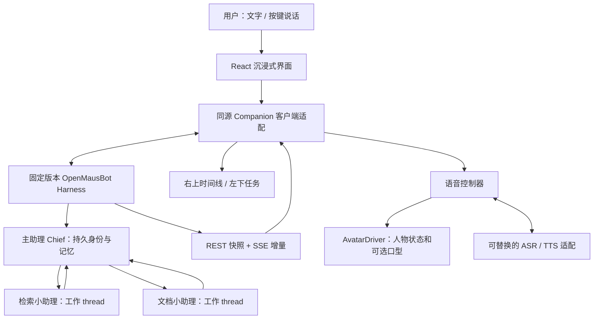

# 沉浸式个人助理首版技术方案 v1.0

版本：v1.0。日期：2026-10-21。状态：review，待 G2/G4 确认。工程代号：openmaus-assistant；产品名称未定。

## 本次要做出的体验

用户在全屏书房里面对同一位主助理。输入“帮我调研并整理成文档”，她派出检索和文档小助理；左下出现真实任务，右上保留交流和工作记录。在任务进行时用户仍可继续聊天。完成后她简短汇报，用户按需查看文件、代码修改和验证证据。

视觉沿用 [批准图](../design/approved-visual-concept-v1.png)：居中人物、右上记录、左下小助理、底部字幕与输入、右下纯净视图。方案不会把图片中的演示代码和任务当作已发生的工作。

## 需求依据与本轮新增决策

| 项目 | 状态 |
|---|---|
| 个人主助理可派遣小助理 | 用户明确需求 |
| 角色陪伴 + 全屏对话 | 用户选择“1和3” |
| 居中人物 + 右上对话和代码修改记录 | 用户明确并认可布局 |
| 书房、人物外观和整体材质 | 用户认可生成图“这款可以” |
| Windows 本地优先、同源客户端、双 thread 调度 | 本轮建议，待确认 |
| 分层照片人物 + 独立口型 POC | 本轮技术建议，待确认；不是批准图自动具备的能力 |
| 首版 1 位主助理、2 位后台小助理 | 为闭环设定的初始规模；不是核心调度上限 |

## 首版范围

包含：沉浸式全屏/窗口切换、文字流式对话、后台派工和回执、聊天与工作记录、记忆查看修订、明确的语音录入与播报控制、失败状态与重连，以及人物技术小样。

小助理初始职责为检索、文档；编码能力作为受控测试任务验证，只有真实差异与测试凭证才展示对应状态。主助理持久身份、记忆和工具范围配置在原生 bot；前台不另建一个隐藏的 agent 推理循环。

第一阶段的习惯能力包括：稳定的交流风格、明确记住用户表达的偏好、可查看和纠正的记忆。重复行为推测、主动提醒、定时执行放在闭环之后；候选必须可见，执行权限沿用原生审批。

本轮范围未包含：移动端、远程公开访问、商业分发、任意控制 Windows 桌面、自动购买/发送外部消息、模型微调、大规模团队或昼夜场景制作。桌面控制仅在后续单独验收其驱动与授权后开放。

## 系统组成

### 运行与源码边界

- React 19 + TypeScript + Vite，与上游技术一致；Windows 桌面壳沿用 Electron 运行方式。正式项目代码待准入后放入本项目 `app/` 和必要的 `adapters/`。
- `upstream/OpenMausBot/` 保持干净并固定提交；正式集成的少量上游变更记录为独立补丁，在开发副本应用，升级先跑契约验证。
- 开发界面将 `/api` 代理到明确指定的隔离 harness。成品由 harness 的 `OMB_STATIC_DIR` 提供构建后的 UI，并沿用桌面壳已有的会话能力、启动和退出逻辑。依据 `server/index.ts:641`、`electron/main.mjs:1185`；打包选择与完整原生窗口仍待实测。
- 不向公网开放 harness，不通过关闭认证或放开 CORS 实现新 UI。模型/语音密钥留在服务端配置，前台拿配置状态。
- 首次使用提供服务、模型、语音的就绪检查。尚未提供真实模型配置时只提供明确标识的隔离演示，不借用其他项目密钥或读取已有私人会话。

### 陪伴与任务并行

同一 Chief bot 保持人物身份，UI 保存 `companionThreadId` 与每项工作的 `workThreadId`。用户聊天进入陪伴 thread；明确工作请求进入独立工作 thread，由 Chief 的原生 `coordinate_bots` 派工。

任务的状态、来源、结果通过服务端记录关联到时间线，不把两条 thread 的私有上下文直接拼入彼此历史。工作结果需要由 Chief 在陪伴聊天里解释时，传递有界摘要与来源链接，并用结果 ID 去重。不能在断线恢复后重复播报或重复提交任务。

本轮已验证同一 Chief 在后台工作未完成时可以在另一条 thread 完成聊天。尚未验证自动把工作结果整合为自然、连贯的人物对话；该部分属于前台适配与真实模型验收。

## 客户端状态与数据契约

| 数据 | 最小字段 | 事实源 |
|---|---|---|
| 会话 | botId、threadId、activeLeafId、分页游标 | 原生 bot/task/message |
| 时间线项 | 稳定 id、threadId、类型、时间、状态、来源、可展开详情 | 持久 message/digest 和规范化事件 |
| 任务 | botId、threadId、openedBy、状态、结果引用 | 原生 task 与 coordinator；前台不另建调度器 |
| 人物状态 | idle/listening/thinking/speaking/attention/offline | 麦克风、播放时钟、当前对话状态 |
| 语音片段 | utteranceId、generation、文字、音频引用、播放状态 | SpeechController |
| 修改凭证 | turnId、文件、前后快照标识、差异可用性、边界提示 | 新增的受限修改适配；当前 digest 不够 |
| 测试凭证 | turnId、命令、工作目录、结束状态、退出码、输出引用 | 实际工具/进程结果；缺失时标记未验证 |

发送复用 `POST /api/bots/:id/messages`，始终指定 threadId 和稳定 sendId；接收 queued 回执显示排队，不显示“已开始”。审批复用 respond 接口并绑定 requestId。任务停止指定 threadId；“停止整个工作”若包含多个子任务，先列出范围再逐项确认结果，不宣称单个 interrupt 自动停止整棵树。

首次建立 SSE 后检查 `hello.resumed`。不可恢复时取 bot/任务快照并刷新相关历史，再接增量；按稳定 ID 合并 message/patch，不能把 delta 当历史重复追加。保留用户滚动锚点，累计新消息提示。

### 修改与测试记录的新增接口草案

建议在正式开发副本增加 `server/routes/` 模块，例如 `GET /api/immersive/threads/:threadId/turns/:turnId/changes`。它是新契约，当前上游没有该接口。

返回受限的文件列表、差异和证据覆盖状态，按授权工作目录与 thread/turn 读取保留的前后快照。设置大小/行数上限，排除密钥、二进制和未授权路径；不接收前台提供的任意磁盘路径。若只有文件名单、快照超时、文件被排除或在远端执行，明确显示差异不可用。无真实前后快照时不计算猜测的 `+N/-N`。

测试状态分为未运行、运行中、通过、失败、已停止、无法验证。只有实际命令结果可确定通过/失败；模型说“通过”、工具调用本身成功、hookCoverage=full 和任务 settled 都不能单独作为依据。

## 语音与人物

首版以“按键说话/点麦克风说话 → 识别文本 → 主助理 → 分句播报”为可控闭环。Windows 上游原生听写不可用，需要独立 ASR 适配；原生 TTS 接口可复用，实际提供方在配置页选择。语音能力未就绪时保留文字并明确提示，不能默认依赖浏览器内置识别或后台常开麦克风。

ASR 最小契约：开始、结束、取消、partial/final/error；录音 session 结束后，迟到的 final 不能重复发送。TTS 以句子预取、队列播放，字幕按播放推进，代码块和长日志不整段念出。每次取消推进 generation，旧合成与片段失效。

“打断播报”立即停止音频并切到倾听/待机；“停止任务”是工作卡的另一个动作。麦克风首次启用才请求系统权限。未验证回声消除与全双工前采用按键/半双工，避免把自己的声音反复识别。后续自然插话单列实机验收。

人物采用独立驱动接口；照片口型与性能、失败回退见 [人物驱动方案](人物驱动方案_v1.0.md)。不会用音量随机开合嘴巴宣称已实现准确口型。

## 记忆和习惯

沿用原生 MEMORY.md、topic files、自动捕获与 journal。显式偏好可记为已确认；模型从重复行为推测出的候选展示为“观察到”，不能直接改成强制规则。

拟议候选结构：`id、scope、statement、evidenceRefs、confidence、status、proposedAt、confirmedAt、expiresAt`。状态为 observed/proposed/confirmed/rejected/paused；只把确认内容写入原生记忆或生成待批准的 routine。候选文件仅保存来源与状态，避免另造一套互相矛盾的事实记忆。

主助理自身的固定习惯用 standing instructions 表达，例如先给简短答复、工作完成再汇报、用户阅读历史时不抢焦点。表情和说话节奏属于人物配置；偏好记忆属于用户可编辑数据；工具权限与定时执行独立。改称呼或喜欢简短回复不会扩大文件/外部操作权限。

## 异常与恢复

| 情况 | 行为 |
|---|---|
| 服务器断开 | 记录显示离线、保存输入草稿；停止虚假的“正在听/说”；重连取快照，不自动重复提交 |
| 子任务失败 | 显示失败原因与已有结果；用户可在明确上下文中重试，不重复创建整批工作 |
| 审批等待 | 任务显示等待你，卡片有执行范围和拒绝入口；不被纯净视图永久遮蔽 |
| 语音权限拒绝 | 麦克风显示不可用并说明如何重开；文字仍可用 |
| ASR/TTS 失败 | 保留识别文本或模型回复，提供针对该片段的重试；不重跑整个任务 |
| 人物 sidecar OOM/退出 | 同一人物静态/待机回退，聊天、音频和任务继续；记日志，不自动下载或换脸 |
| 记忆写入 409 | 保留编辑内容，展示服务端版本，人工合并后提交；不盲目覆盖 |
| 停止后迟到结果 | 保留真实结束状态；旧语音 generation 不能继续播放，不能把已停止任务改成成功 |
| 成品退出 | 回收拥有的语音/人物服务与连接；后台任务是否继续在退出前明确展示，不按进程名批量杀进程 |

## 实施顺序和验收

| 阶段 | 可审阅产物 | 通过条件 |
|---|---|---|
| A 人物小样与资产 | 无 UI 背景、独立人物、照片口型小样和本机性能表 | 保持已批准人物；如实给出 GTX 1070 数据；不达标采用明确回退 |
| B 沉浸式界面 | 全屏书房、人物层、记录/工作展开、输入和纯净视图 | 1920×1080 与 1366×768 无关键遮挡；键盘可操作；减少动效有效；状态演示有标识 |
| C 真实文字和派工 | 主助理 + 两名小助理 + 真实时间线 | 同时派工、后台工作时可聊天、返回可打开产物；暂停/失败/重连不重复任务 |
| D 语音与记忆 | Windows 语音入口、分句播报、打断、记忆抽屉 | 中文对话走通；打断播报不停止后台任务；记忆可纠正且跨重启保持 |
| E 代码与质量验收 | 受控示例项目 diff、测试凭证、故障记录 | 真实修改匹配实际文件；失败测试不能显示通过；指定任务停止不影响其他工作 |

先对 A 的照片驱动做短验证，再确定默认驱动；B/C 不等待高成本人物研究全部完成。每一阶段分别记录已实现、演示和待验证，发布前 G5/G7 另外执行。

正式验收用例：指定一个仅含测试数据的工作目录，用户提出调研和文档任务，主助理委派两位小助理；同时进行一次闲聊；完成后打开产物。再在示例代码中做一处可控修改，分别执行成功和失败命令验证记录；中途打断语音，并停止一条工作 thread，确认其余任务继续。

本轮只完成上游隔离验证 10 项和本方案，不宣称 A～E 已实现。真实模型质量、语音端到端延迟、图像一致性、角色动作和成品打包均待验证。

## 设计复核与准入记录

已完成：批准视觉对齐；上游接口核对；双 thread 可行性实测；接口来源与新接口区分；人物不达标回退；重连/停止/冲突/权限状态；可检验的验收目标。该记录是本轮设计自检，不冒充独立代码审查签字。

G1：核心需求和视觉有确认；新增首版细项列于本方案。G2：待用户审阅本方案和 UI 系统。G4：待用户确认按该范围进入正式开发。G5：正式实现后评审。G7：未申请发布。

本轮授权已用于调研、最小验证、设计和资料保存。下一次确认可一并覆盖本方案 G2、首版 G4，以及 P0 全局入口增加本项目/当前活跃项目的登记；后续仍须按实现结果完成 G5/G7，不将确认扩展为生产发布或远程部署。

P0 登记的具体拟改内容如下，当前未应用：在 `Agent文档/main.md` 项目表增加 `openmaus-assistant | 活跃（首版开发） | projects/openmaus-assistant/ | 共享Agent | 标准（5级）`；将“当前活跃项目”改为本项目，原有竞品/其他项目状态与历史信息原样保留为先前记录；补充本项目领域简介（固定上游版本、批准视觉、10项隔离验证与待完成的真实模型/语音/人物验收），并更新入口版本/日期。不会修改核心规则、专注模式或其他项目结论。
